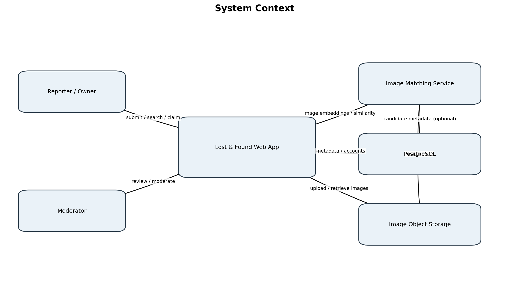
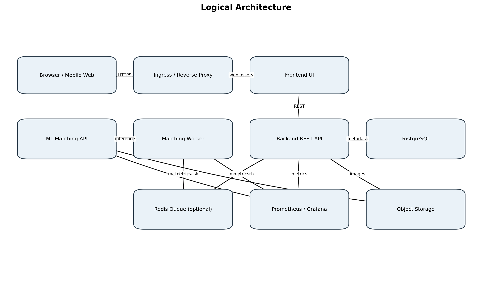
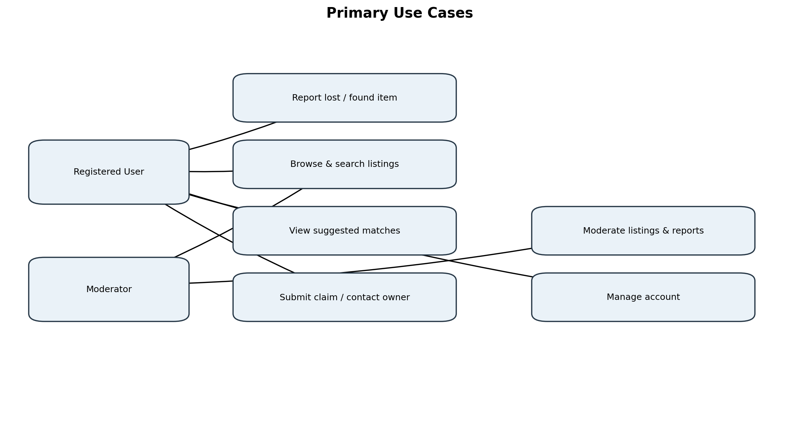
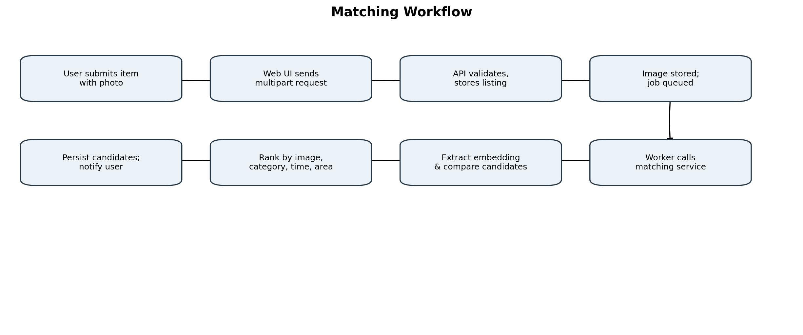
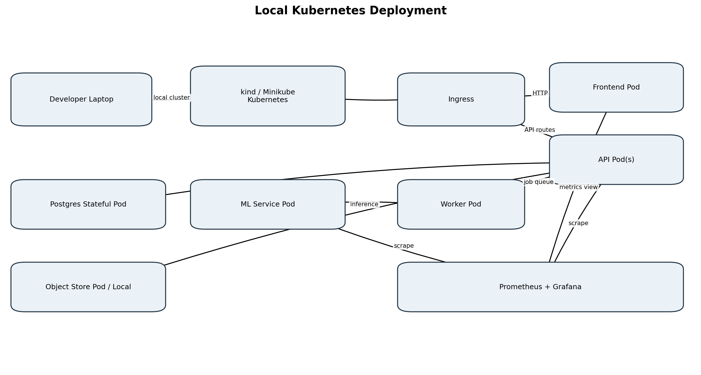
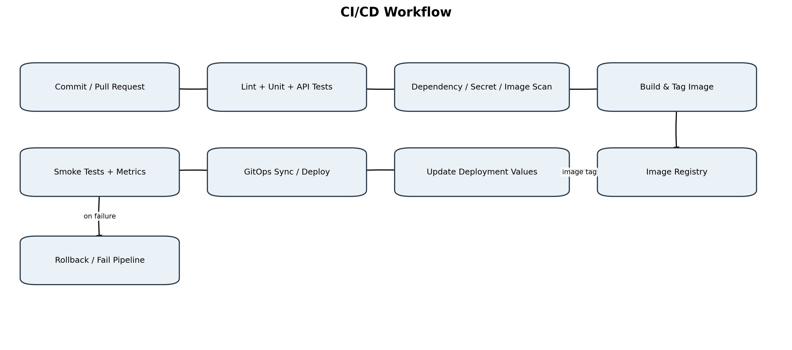
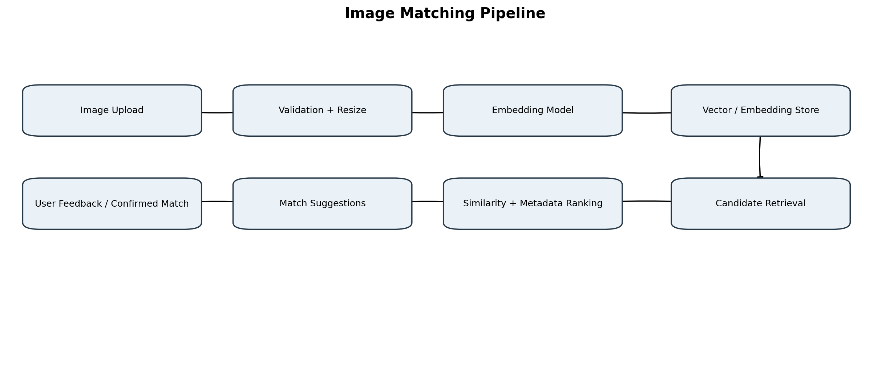
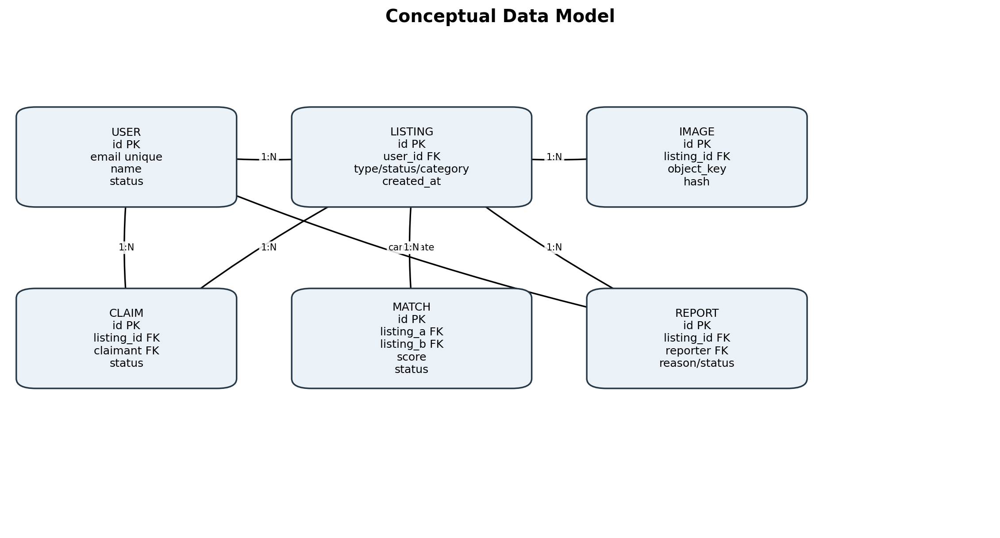

> Original SRS v1.0, converted from `Lost_and_Found_SRS_v1.docx`. Where the project plan differs (Docker Hub instead of GHCR, ELK added, HashiCorp Vault, Jenkins deploying locally on the server Mac), `../plan.md` wins.

**SOFTWARE REQUIREMENTS\
SPECIFICATION**

**Lost & Found with Image-Based Matching**

Version 1.0 \| Draft for Capstone Project

CSE 816 — Software Production Engineering\
M.Tech (CSE), Term I, 2026–27\
End-to-End DevOps Capstone \| Team of Two

# Document Control

| **Field** | **Value** |
|----|----|
| Document | Software Requirements Specification (SRS) |
| Project | Lost & Found with Image-Based Matching |
| Version | 1.0 — Draft |
| Status | Proposed; requirements to be validated by the team/faculty |
| Intended audience | Project team, faculty evaluator, testers, and demo audience |
| Primary deployment target | Laptop-runnable local Kubernetes (kind on Colima) on a dedicated server MacBook reached over Tailscale; Jenkins + Ansible deliver releases |
| Project delivery | Source code, pipeline, manifests, report, demo, backup recording |

## Revision History

| **Version** | **Date** | **Description** |
|----|----|----|
| 1.0 | 23-Nov-2026 | Initial comprehensive SRS draft |
| 1.1 | 23-Nov-2026 | Toolchain updated: Jenkins + Ansible deployment to a server MacBook over Tailscale; multi-stage container standards; end-to-end DevSecOps pipeline (Gitleaks, Semgrep, Trivy, Syft, Cosign, Kyverno, ZAP) |

# Table of Contents

In Word, update the Table of Contents field if desired. The document is organized by numbered sections for review and traceability.

1\. Introduction

2\. Overall Description

3\. System Context and Architecture

4\. Functional Requirements

5\. External Interface Requirements

6\. Data Requirements and Database Design

7\. Image-Matching / ML Requirements

8\. Non-Functional Requirements

9\. Security, Privacy and Abuse Controls

10\. DevOps, Deployment and Observability Requirements

11\. Failure Handling and Recovery

12\. Testing and Verification

13\. Acceptance Criteria

14\. Project Plan and Incremental Delivery

15\. Requirement Traceability Matrix

16\. Risks, Assumptions and Open Decisions

Appendix A. Proposed API Summary

Appendix B. Glossary

# 1. Introduction

## 1.1 Purpose

This SRS defines the requirements for a web-based Lost & Found platform that helps people report lost or found belongings and discover possible matches. The platform will use image similarity as one signal, combined with item category, textual attributes, time, and approximate location, to recommend likely matches. The system is intended to be developed incrementally and delivered through a complete automated DevOps lifecycle for the CSE 816 capstone.

## 1.2 Product Scope

The product allows users to create accounts, submit lost/found reports, upload item photographs, browse and filter reports, receive ranked match suggestions, and initiate a safe claim/contact workflow. Moderators can review reports, remove abusive or fraudulent content, and resolve disputes. A matching service will extract visual representations from images and compare candidate items. Matching recommendations are advisory; users and moderators make the final determination.

## 1.3 Goals

- Reduce the effort and time required to reunite owners with lost belongings.

- Make item discovery easier than manually browsing many posts.

- Provide ranked, explainable candidate matches rather than a black-box yes/no result.

- Protect personal information by limiting public contact details and exact location exposure.

- Demonstrate incremental development, automated CI/CD, containerization, local Kubernetes deployment, IaC/configuration management, monitoring, and a cutting-edge ML/MLOps extension.

- Keep the full demonstration reproducible on a student laptop without paid cloud services.

## 1.4 In-Scope Features

- Registration, authentication, profile management, and role-based access.

- Lost and found listing creation, editing, closure, and image upload.

- Listing search, filtering, sorting, and pagination.

- Image-based candidate matching combined with metadata signals.

- Match score, ranked results, and feedback (helpful/not helpful; confirmed match).

- Private claim/contact workflow that avoids publishing personal contact details.

- Notifications for new match suggestions and listing status changes.

- Moderation tools, user reports, and audit trail for moderation actions.

- Metrics, logs, health checks, and dashboards.

- Automated tests, security scanning, image build, deployment, and verification.

## 1.5 Out of Scope for Initial Release

- Payments, rewards, or escrow.

- Identity verification through government documents.

- Real-time GPS tracking or exact public location display.

- Native Android/iOS applications (responsive web only).

- Guaranteeing that a suggested match is correct; the system only ranks candidates.

- Production-scale multi-region deployment or cloud hosting.

- Training a custom deep neural network from scratch; initial implementation may use a pretrained embedding model.

- Automated public messaging or sharing contact information without user consent.

## 1.6 Definitions and Acronyms

| **Term** | **Definition** |
|----|----|
| Lost listing | A report created by a person who cannot find an item they own or possess. |
| Found listing | A report created by a person who has found an item and wants to return it. |
| Candidate match | A pair of lost and found listings that may refer to the same item. |
| Embedding | A numeric vector representing visual characteristics of an image. |
| Similarity score | A normalized score estimating visual similarity between image embeddings. |
| Desired state | Declared deployment configuration maintained in version control. |
| CI/CD | Continuous Integration / Continuous Delivery or Deployment. |
| MLOps | Practices for versioning, testing, serving, and monitoring machine-learning components. |
| RBAC | Role-Based Access Control. |
| SLO | Service Level Objective. |
| K8s | Kubernetes. |

# 2. Overall Description

## 2.1 Product Perspective

The system is a browser-based application with a frontend, backend API, relational database, image storage, asynchronous matching worker, and independently deployable image-matching service. The application is designed as a modular service-oriented system while remaining small enough for a local Kubernetes cluster. The matching service is separated so that model and inference dependencies can be updated independently from the business API.

## 2.2 User Classes and Characteristics

| **User class** | **Description** | **Key permissions** |
|----|----|----|
| Visitor | Unauthenticated person exploring public listings. | Browse public listings and search; cannot create listings or contact users. |
| Registered user / Reporter | Person who reports a lost or found item. | Create/edit own listings, upload photos, view matches, submit claims, provide feedback, manage account. |
| Owner / Claimant | User who believes a found listing matches their lost item or vice versa. | Initiate claim and provide non-public proof/description; communicate through platform workflow. |
| Moderator | Trusted user managing reports and platform content. | Review reports, hide/remove listings, suspend accounts, resolve abuse reports, inspect moderation audit. |
| Administrator | Operator responsible for platform configuration. | Manage roles/configuration, operational settings, system health; should not routinely access user content. |

## 2.3 Operating Environment

- Supported modern browsers: latest stable Chrome, Firefox, Edge, and Safari; responsive layout for mobile and desktop.

- Development environment: Linux, macOS, or Windows with Docker-compatible runtime and local Kubernetes.

- Cluster: kind (on Colima) on a dedicated server MacBook reached over Tailscale SSH; project must not require a paid cloud account. Apple Silicon host: images must be linux/arm64 or multi-arch.

- Application containers: Linux containers.

- CI/CD server: Jenkins on the server MacBook, triggered by GitHub webhooks exposed through Tailscale Funnel (SCM polling as fallback). Deployment is performed by Ansible over Tailscale SSH.

- Persistent storage: Kubernetes PersistentVolume for local database/object store where supported, or documented local storage configuration.

## 2.4 Design and Implementation Constraints

- Team size is two; implementation should be divided into independently testable modules.

- All core functionality must run locally for viva demonstration.

- Images must be validated and size-limited; uploads must not be trusted.

- Do not commit credentials, private keys, or real user data to source control.

- Use a pretrained image-embedding model or an appropriately small model; inference should fit CPU-only laptop resources.

- Use progressive, reviewable Git commits from both team members.

- One code change should trigger automated test, build, image publication/tagging, and deployment to the local cluster through a documented workflow. Jenkins runs on the same server MacBook as the cluster, so no hosted runner or GitOps controller is needed (see ADR-005).

## 2.5 Assumptions and Dependencies

- Users provide reasonably clear photographs and accurate descriptions.

- Lost and found reports have enough metadata to narrow candidate pairs.

- The pretrained model and required libraries are available during image build or are cached for offline demo.

- Email notifications may be simulated or delivered through a local development mail sink; no paid mail service is required.

- Map/location features use approximate location or campus/building selection; exact coordinates are not publicly exposed.

- Object storage may be MinIO or a compatible local solution; alternatively, a persistent volume may be used for the prototype.

## 2.6 User Environment and Usage Scenarios

- A student loses a water bottle on campus, submits a report with a photo, category, date, and approximate location.

- Another student reports a found bottle. The matching engine ranks the lost report as a likely match.

- The owner receives a notification, reviews the candidate, and initiates a claim.

- The finder and owner exchange limited details through a claim workflow and arrange return.

- A moderator reviews a suspicious listing or a disputed claim and takes action.

# 3. System Context and Architecture

## 3.1 Context Diagram

*Figure 1. System context and external actors/services.*

The web application is the central system boundary. Users and moderators interact through the browser. The application stores structured data in PostgreSQL, images in object storage, and calls the matching service to calculate visual similarity.

## 3.2 Proposed Logical Architecture

*Figure 2. Proposed logical components and communication paths.*

## 3.3 Component Responsibilities

| **Component** | **Responsibility** |
|----|----|
| Frontend | Responsive UI, forms, listing search, match display, account/claim views, moderator interface. |
| Backend API | Authentication, authorization, validation, business rules, listing/claim/report APIs, persistence, notifications, orchestration. |
| Matching worker | Asynchronous match job execution, candidate retrieval, ranking, persistence, retry handling. |
| Image-matching service | Image validation/preprocessing, embedding extraction, similarity computation, optional model metadata endpoint. |
| PostgreSQL | Users, listing metadata, match results, claims, reports, notifications, audit records. |
| Object storage | Original and optionally resized images; access through controlled URLs or API. |
| Queue (optional) | Decouple listing creation from matching computation; Redis-backed queue may be used. |
| Prometheus/Grafana | Metrics collection, dashboards, alerting for application and cluster health. |

## 3.4 Architecture Rationale

- Separate matching from the API so model dependencies and CPU usage do not block ordinary request handling.

- Use asynchronous matching so listing creation remains responsive.

- Use PostgreSQL for relational consistency, filtering, and durable workflow state.

- Store image bytes outside the relational database; store metadata and object keys in PostgreSQL.

- Use a local cluster to make the deployment reproducible and demonstrable without cloud cost.

- Keep optional infrastructure (queue, vector index, tracing) replaceable and avoid adding components unless needed for scope.

## 3.5 Use-Case Diagram

*Figure 3. Main use cases for registered users and moderators.*

## 3.6 Matching Sequence Diagram

*Figure 4. Asynchronous image-matching flow.*

## 3.7 Deployment Diagram

*Figure 5. Laptop-runnable local Kubernetes deployment.*

## 3.8 CI/CD Diagram

*Figure 6. Proposed automated build, test, scan, deployment, and verification workflow.*

## 3.9 ML Workflow Diagram

*Figure 7. Image preprocessing, embedding, retrieval, ranking, and feedback workflow.*

# 4. Functional Requirements

Each requirement has a unique identifier and is testable. Priority is MoSCoW: Must, Should, Could.

| **ID** | **Requirement** | **Description** | **Priority** |
|----|----|----|----|
| FR-001 | Account registration | The system shall allow a user to register using a unique email address and password. | Must |
| FR-002 | Authentication | The system shall authenticate registered users and provide a logout operation. | Must |
| FR-003 | Profile management | The system shall allow users to update a display name and limited profile fields. | Should |
| FR-004 | Role authorization | The system shall enforce roles for user, moderator, and administrator operations. | Must |
| FR-005 | Create listing | A registered user shall create a lost or found listing with title, category, description, date/time range, approximate location, and at least one photo. | Must |
| FR-006 | Upload validation | The system shall validate file type, file size, dimensions, and content before accepting an image. | Must |
| FR-007 | Edit own listing | A user shall edit or withdraw their own listing while it is active. | Must |
| FR-008 | Listing lifecycle | A listing shall have statuses Draft, Active, Matched/Claim Pending, Resolved, Closed, and Removed; allowed transitions shall be enforced. | Must |
| FR-009 | Browse listings | Users shall browse active listings with pagination and sorting. | Must |
| FR-010 | Search and filters | Users shall search by text and filter by type, category, date range, and approximate area. | Must |
| FR-011 | Listing detail | The system shall display listing details and safe image access without exposing private contact details. | Must |
| FR-012 | Candidate matching | The system shall generate candidate lost/found pairs for matching when a listing is created or updated. | Must |
| FR-013 | Match ranking | The system shall rank candidates using image similarity and metadata signals and return a score plus contributing signals where feasible. | Must |
| FR-014 | Match threshold | The system shall apply configurable score thresholds to classify candidate matches as high, medium, or low confidence. | Must |
| FR-015 | Match visibility | Users shall see only match suggestions relevant to their listings and only listings they are authorized to view. | Must |
| FR-016 | Match feedback | Users shall mark a suggestion helpful, not helpful, or confirmed; feedback shall be recorded. | Should |
| FR-017 | Notification | The system shall notify a user when a new high-confidence candidate is found for their active listing. | Must |
| FR-018 | Claim initiation | A user shall initiate a claim/contact request for a found listing or candidate match. | Must |
| FR-019 | Claim details | The claimant shall provide private identifying details about the item that are not necessarily shown publicly. | Must |
| FR-020 | Claim review | The listing owner/finder shall accept, reject, or request further information for a claim; moderators may intervene. | Must |
| FR-021 | Resolution | Authorized parties shall mark a listing/claim resolved and close further claim actions. | Must |
| FR-022 | Report listing | Users shall report suspicious, inappropriate, duplicate, or incorrect listings. | Must |
| FR-023 | Moderation queue | Moderators shall review reports and take actions such as hide, restore, remove, or suspend. | Must |
| FR-024 | Audit trail | The system shall record security-sensitive and moderation actions with actor, timestamp, action, and target. | Must |
| FR-025 | Notifications inbox | Users shall view in-app notifications and mark them read. | Should |
| FR-026 | Admin settings | Administrators shall configure match thresholds, upload limits, and selected system settings. | Should |
| FR-027 | Health endpoints | Services shall expose health/readiness endpoints suitable for Kubernetes probes. | Must |
| FR-028 | Metrics | The backend and matching service shall expose metrics for request volume, latency, errors, matching jobs, and inference duration. | Must |
| FR-029 | Model information | The matching service shall expose model name/version and inference configuration for traceability. | Should |
| FR-030 | Data export/delete | Users shall be able to request account deletion; the system shall remove or anonymize personal data subject to retention rules. | Should |

## 4.1 Listing Fields and Validation

| **Field** | **Required?** | **Validation / notes** |
|----|----|----|
| Type | Yes | Lost or Found. |
| Title | Yes | 2–100 characters; avoid personal data. |
| Category | Yes | Controlled vocabulary; e.g., electronics, ID/cards, keys, bags, clothing, accessories, books, other. |
| Description | Yes | 10–1000 characters; users encouraged to omit secret identifying details from public text. |
| Date/time lost or found | Yes | Date/time or bounded range; reject unreasonable future dates unless configured. |
| Approximate location | Yes | Campus/building/area selection; do not publish precise coordinates. |
| Image | At least one | JPEG/PNG/WebP; maximum size and count configurable; proposed initial max 5 images, 5 MB each. |
| Status | System-managed | Transitions enforced by API; user cannot directly set arbitrary state. |
| Visibility | System-managed | Active public listing, hidden, resolved, removed; moderator override. |

## 4.2 Listing Lifecycle

> Draft → Active → Claim Pending → Resolved → Closed\
> ↘ Moderation Hidden → Active / Removed\
> Active → Closed (withdrawn by owner)\
> Claim Pending → Active (claim rejected/withdrawn) or Resolved (successful return)

Status transitions must be enforced server-side. The system should retain a minimal history for audit and avoid allowing users to reopen a resolved listing without a defined rule.

## 4.3 Claim and Return Workflow

1.  Claimant opens a listing or match suggestion and requests contact/claim.

2.  Claimant provides private proof or distinctive item details.

3.  Finder/owner receives a notification and reviews the request.

4.  Recipient accepts, rejects, or requests more information.

5.  If accepted, the parties use a privacy-preserving contact method or coordinate a return.

6.  After the item is returned, an authorized user marks the claim resolved; listing(s) are closed or marked resolved.

7.  Moderators can intervene when a claim is disputed or abuse is reported.

# 5. External Interface Requirements

## 5.1 User Interface Requirements

- The interface shall be responsive for phone, tablet, and desktop widths.

- Forms shall provide clear validation messages and preserve safe entered data on validation failure.

- Uploaded images shall display previews and allow removal before submission.

- Listing cards shall show thumbnail, title, category, lost/found status, approximate area, and date.

- Match suggestions shall show similarity confidence as a descriptive band (not imply certainty), image previews, shared metadata, and actions.

- Accessibility: controls shall be keyboard reachable; form labels shall be associated with controls; images shall have alt text; status shall not rely only on color.

- Moderation views shall clearly distinguish reported content and available actions.

## 5.2 API Interface

The backend shall expose a versioned REST API, proposed prefix /api/v1. JSON is used for ordinary requests and multipart/form-data for image uploads. Authentication may use secure session cookies or bearer tokens; the implementation must select one and document it.

| **Endpoint (proposed)** | **Method** | **Purpose** | **Auth** |
|----|----|----|----|
| /auth/register | POST | Register account | Public |
| /auth/login | POST | Authenticate | Public |
| /auth/logout | POST | End session | Authenticated |
| /users/me | GET/PATCH | Current profile | Authenticated |
| /listings | GET | Browse/search/filter | Public or policy-limited |
| /listings | POST | Create listing | Authenticated |
| /listings/{id} | GET | Listing detail | Public/authorized |
| /listings/{id} | PATCH | Update own listing | Owner/moderator |
| /listings/{id}/images | POST | Upload image(s) | Owner |
| /listings/{id}/matches | GET | Candidate suggestions | Owner/authorized |
| /matches/{id}/feedback | POST | Feedback | Authenticated |
| /claims | POST | Initiate claim | Authenticated |
| /claims/{id} | GET/PATCH | View/update claim | Participants/moderator |
| /notifications | GET | Inbox | Authenticated |
| /notifications/{id}/read | PATCH | Mark read | Owner |
| /reports | POST | Report listing/user | Authenticated |
| /moderation/reports | GET | Review queue | Moderator |
| /moderation/reports/{id} | PATCH | Moderation decision | Moderator |
| /health/live | GET | Liveness | Internal |
| /health/ready | GET | Readiness | Internal |
| /metrics | GET | Prometheus metrics | Internal |

## 5.3 Matching Service Interface

| **Endpoint** | **Method** | **Purpose** |
|----|----|----|
| /health | GET | Service health. |
| /ready | GET | Model loaded and service ready. |
| /model-info | GET | Model identifier, version, preprocessing configuration. |
| /embed | POST | Return embedding for uploaded image or image reference (internal only). |
| /similarity | POST | Compare two images and return visual similarity score. |
| /metrics | GET | Inference metrics for Prometheus. |

## 5.4 API Error Handling

- Errors shall use a consistent JSON structure with code, message, and optional field-level details.

- HTTP status codes shall be used consistently: 400 invalid request, 401 unauthenticated, 403 forbidden, 404 not found, 409 conflict, 413 upload too large, 415 unsupported media type, 422 validation error, 429 rate limited, 500 unexpected error, 503 dependency unavailable.

- Responses shall not expose stack traces, SQL, secrets, or internal object-storage paths.

- Request IDs shall be returned and included in structured logs for correlation.

# 6. Data Requirements and Database Design

## 6.1 Conceptual Entity Relationship Diagram

*Figure 8. Conceptual ER model; fields shown are illustrative and may be expanded.*

## 6.2 Entities

| **Entity** | **Key attributes** | **Purpose** |
|----|----|----|
| User | id, email, password_hash, display_name, role, status, created_at | Account and permissions. |
| Listing | id, owner_id, type, title, description, category, date_range, area, status, created_at, updated_at | Lost/found report. |
| Image | id, listing_id, object_key, mime_type, size, checksum, dimensions, created_at | Image metadata and storage reference. |
| Embedding (optional) | image_id, model_version, vector, created_at | Vector representation for image matching; may reside in a separate vector index. |
| Match | id, lost_listing_id, found_listing_id, image_score, metadata_score, final_score, status, model_version, created_at | Ranked candidate pair. |
| Claim | id, listing_id, claimant_id, status, private_proof, created_at, updated_at | Claim/return workflow. |
| Report | id, listing_id, reporter_id, reason, status, moderator_id, resolution | Abuse reporting. |
| Notification | id, user_id, type, payload, read_at, created_at | In-app notifications. |
| AuditEvent | id, actor_id, action, target_type, target_id, metadata, created_at | Sensitive action history. |

## 6.3 Data Integrity

- Foreign keys shall prevent orphan records for users, listings, images, claims, and matches.

- Email shall be unique after normalization.

- Match pairs shall be unique regardless of pair order (lost/found orientation should be canonical).

- Deleting a listing shall remove or invalidate dependent images, matches, and claims according to retention rules.

- Match score values shall be bounded to the chosen normalized range.

- State transitions shall be validated in the application and, where practical, constrained in the database.

- Database migrations shall be versioned, reviewed, and executed as part of deployment.

## 6.4 Retention and Backup

- Images associated with removed listings shall be deleted or quarantined according to retention policy.

- Account deletion shall anonymize or remove personal data while preserving only necessary non-identifying audit records.

- Local demo database backups shall be documented; a backup and restore test should be performed before final demo.

- Backups must not include secrets in the repository.

# 7. Image-Matching / ML Requirements

## 7.1 Intended ML Capability

The matching component shall use a pretrained image representation model to generate embeddings for item photographs and compare them with embeddings of eligible candidate listings. A simple cosine similarity baseline is acceptable for the capstone; a custom-trained model is not required. Metadata-based scoring shall supplement visual similarity.

## 7.2 Matching Pipeline

*Figure 9. Image embedding and candidate-ranking pipeline.*

## 7.3 Matching Algorithm (Proposed Baseline)

> visual_score = cosine_similarity(embedding_lost, embedding_found)\
> category_score = 1.0 if categories match else category_similarity\
> location_score = proximity_bucket(approximate_areas)\
> time_score = recency_overlap_or_distance(lost_found_dates)\
> text_score = optional_description_similarity\
> final_score = weighted_sum(normalized_signals)

Weights and thresholds are configurable and must be evaluated with a small manually labelled validation set. The system shall not claim certainty based solely on the score. The initial implementation may use visual score plus category, area, and time; text similarity is optional.

## 7.4 Candidate Selection

- Only opposite listing types (Lost vs Found) shall be matched by default.

- Only active listings within configured date and area windows shall be candidates.

- Listings already resolved, removed, or blocked shall be excluded.

- Candidate retrieval shall be bounded to prevent unbounded pairwise comparisons.

- Matching jobs shall be idempotent; retries must not create duplicate match records.

- An updated listing or image shall trigger recomputation or invalidate stale match results.

## 7.5 Model Serving and Versioning

- The model shall be packaged with the matching service image or loaded from a pinned, documented artifact.

- Model identifier, version, preprocessing settings, and image version shall be observable.

- Changing model version shall trigger regression tests against a fixed validation set.

- CPU-only inference shall be supported for the local demonstration.

- Model startup and readiness shall be separated from liveness; readiness shall fail until the model is loaded.

- Model input shall be validated and inference time/exception metrics recorded.

## 7.6 Evaluation Metrics

| **Metric** | **Definition / use** |
|----|----|
| Precision@K | Of the top K suggestions, proportion that are true matches. |
| Recall@K | Of labelled true matches, proportion appearing in the top K. |
| Top-1 accuracy | Whether the highest-ranked candidate is a true match for labelled examples. |
| False positive rate | Fraction of non-match pairs incorrectly presented as high-confidence. |
| Inference latency | Time spent extracting embedding and computing similarity. |
| Coverage | Fraction of new listings for which matching successfully produces candidate results. |

The team shall create a small test set containing positive and negative pairs (e.g., 30–100 pairs if feasible), document its limitations, and report at least one ranking metric. If a labelled dataset cannot be assembled, use a controlled demo dataset and clearly identify it as synthetic/test data.

## 7.7 Feedback and Improvement

- Feedback shall be collected only from authenticated users and associated with match IDs.

- Feedback must not automatically retrain the model during the live demo unless a safe, repeatable pipeline is implemented.

- Feedback may be exported as a dataset for offline evaluation.

- Any retraining or model promotion process shall include validation and a versioned artifact.

# 8. Non-Functional Requirements

| **ID** | **Category** | **Requirement** | **Priority** |
|----|----|----|----|
| NFR-001 | Performance | Listing search shall return within 2 seconds at the 95th percentile for the demo dataset (target: up to 10,000 listings). | Must |
| NFR-002 | Performance | Listing creation shall return confirmation within 3 seconds excluding asynchronous matching. | Must |
| NFR-003 | Matching | A single-image embedding request shall complete within 5 seconds on the team’s reference laptop after model warm-up, subject to model choice. | Should |
| NFR-004 | Availability | For the local demonstration, all core services shall start through documented commands/manifests and recover from pod restart. | Must |
| NFR-005 | Scalability | API and matching components shall be deployable with multiple replicas where stateless; DB and storage limitations shall be documented. | Should |
| NFR-006 | Reliability | Matching jobs shall support retry with bounded attempts and failure state; duplicate jobs shall not duplicate results. | Must |
| NFR-007 | Security | Passwords shall be hashed using a modern password-hashing algorithm; plaintext passwords shall never be stored. | Must |
| NFR-008 | Security | All protected APIs shall enforce authentication and object-level authorization. | Must |
| NFR-009 | Privacy | Exact location and user contact details shall not be displayed publicly by default. | Must |
| NFR-010 | Privacy | Claim proof/details shall be visible only to authorized claim participants and moderators. | Must |
| NFR-011 | Usability | A user shall be able to submit a listing in a guided flow with validation and photo preview. | Must |
| NFR-012 | Accessibility | Core workflows shall support keyboard navigation, semantic labels, and readable contrast. | Should |
| NFR-013 | Maintainability | Backend, frontend, worker, and ML service shall have documented interfaces and automated tests. | Must |
| NFR-014 | Portability | The entire core system shall run on a local Kubernetes cluster without a paid cloud dependency. | Must |
| NFR-015 | Observability | Services shall expose structured logs, metrics, health probes, and request/job correlation IDs. | Must |
| NFR-016 | Resource use | The system shall document minimum laptop resources and provide a reduced-resource profile. | Must |
| NFR-017 | Data integrity | Database migrations shall be repeatable and backwards-compatible where possible during rolling updates. | Should |
| NFR-018 | Compatibility | The web UI shall work on current stable desktop and mobile browsers. | Must |
| NFR-019 | Rate limiting | Authentication and upload endpoints shall have rate limits or equivalent abuse controls. | Should |
| NFR-020 | Configuration | Runtime configuration shall be externalized; secrets shall not be baked into images. | Must |

# 9. Security, Privacy and Abuse Controls

## 9.1 Threats

- Malicious upload (script, oversized file, decompression bomb, malformed image).

- Account takeover or brute-force login.

- Unauthorized access to another user’s listing, claim, or private proof.

- Scraping or enumeration of users/listings.

- Spam, scam, fake found-item reports, harassment, or inappropriate images.

- Exposure of exact location, email, phone number, or sensitive item details.

- Container image vulnerability or leaked secret in source/pipeline.

- Dependency or model artifact supply-chain compromise.

## 9.2 Security Requirements

- Use HTTPS where supported in the local setup; document local certificate limitations.

- Validate image bytes and decode/re-encode images where practical; do not trust filename extensions.

- Set maximum upload size, image count, pixel dimensions, and allowed formats.

- Store passwords using Argon2id, bcrypt, or another vetted password-hashing implementation.

- Use secure, HttpOnly, SameSite cookies if cookie-based sessions are chosen; protect state-changing requests against CSRF.

- Enforce ownership checks for listing updates, claims, match views, and image access.

- Use RBAC for moderator/admin functions and audit moderation actions.

- Rate-limit login, registration, reports, and uploads.

- Scan dependencies and container images in CI; secret scanning shall fail on detected credentials.

- Run containers as non-root, use read-only filesystem where feasible, drop unnecessary capabilities, and set resource requests/limits.

- Use Kubernetes Secrets for demo credentials and document that basic Secrets are not encrypted at rest by default unless cluster encryption is configured.

- Apply NetworkPolicies where the chosen local cluster CNI supports enforcement; otherwise document the limitation.

## 9.3 Privacy Principles

- Public listings should use approximate area, not precise coordinates.

- Public view should not reveal the reporter’s email, phone, or account identifier.

- Private claim evidence should be minimized and access-controlled.

- Users should be warned not to publish serial numbers, ID numbers, passwords, or uniquely identifying private details.

- Use synthetic data and sample images in the capstone demo; do not use real sensitive documents.

- Define and document a deletion/retention policy even if the prototype implements only a basic deletion flow.

# 10. DevOps, Deployment and Observability Requirements

## 10.1 Proposed Toolchain

| **Lifecycle stage** | **Proposed tool** | **Deliverable / verification** |
|----|----|----|
| Source control | GitHub | Repository, branch/PR workflow, commit history from both members. |
| CI/CD | Jenkins (Declarative Pipeline) | Webhook-triggered lint, tests, security checks, build and deploy stages on push/PR. |
| Build | Docker | Reproducible multi-stage container images (buildx, linux/arm64) tagged with the commit SHA. |
| Image registry | GHCR or local registry | Published image and immutable tag/digest. |
| Configuration/IaC | Ansible + Helm | Ansible roles provision the server Mac (Colima, kind) and run deployments; Helm gives parameterized, repeatable install/upgrade. |
| Orchestration | kind on Colima (server MacBook) | Local Kubernetes deployment. |
| Remote access / delivery | Tailscale SSH + Funnel | Private SSH for Ansible; Funnel exposes only the Jenkins /github-webhook/ endpoint. |
| Monitoring | Prometheus | Scrape app, matching service, worker, and cluster metrics. |
| Dashboards | Grafana | Application, matching, and cluster dashboards. |
| Security scanning | Trivy (fs + image) | Dependency and image CVE reports; critical findings block the build. |
| Secret scanning | Gitleaks | Pre-commit hook and Jenkins stage; any finding fails the build. |
| SAST | Semgrep (SonarQube optional) | Code findings on every build; high severity blocks. |
| Dockerfile / IaC lint | Hadolint + Trivy config | Dockerfiles, Helm charts and Ansible checked; high severity blocks. |
| SBOM | Syft (CycloneDX) | SBOM archived per image as a Jenkins artifact. |
| Image signing | Cosign | Images signed after scanning; unsigned images rejected in cluster. |
| Admission policy | Kyverno | Rejects unsigned images, root containers, missing limits. |
| DAST | OWASP ZAP baseline | Scan of the deployed app; high findings fail the stage. |
| ML extension | Pretrained embeddings + versioned model service | Model version, tests, metrics, deployment. |

## 10.2 Incremental Pipeline

*Figure 10. Automated pipeline (deployment mechanism should be adapted to local cluster access).*

8.  Developer pushes branch and opens a pull request.

9.  Jenkins receives the GitHub webhook and runs formatting/linting, unit tests, API tests, and frontend checks.

10. Gitleaks (secrets), Semgrep (SAST), Trivy (dependencies, image, Helm/Ansible config) and Hadolint (Dockerfiles) run; critical or high policy findings block the build according to configured thresholds. Syft generates a CycloneDX SBOM and Cosign signs each image after it passes the scans.

11. Merge to main triggers production-like build; image tags include commit SHA and optionally semantic version.

12. Images are pushed to registry or loaded into local kind cluster as part of documented local workflow.

13. Jenkins invokes an Ansible playbook over Tailscale SSH, which applies the Helm release to the kind cluster on the server MacBook.

14. Smoke tests verify readiness, listing creation/search, image upload, and matching endpoint; an OWASP ZAP baseline scan then runs against the deployed app. Kyverno admission rejects unsigned images, root containers and workloads without resource limits.

15. Metrics and dashboards confirm service health; failed rollout is halted or rolled back.

## 10.3 Local Cluster Deployment

Hosted CI cannot reach a private laptop cluster, so the selected design is: Jenkins and the kind cluster (on Colima) both run on a dedicated server MacBook reached from the developer machine over Tailscale SSH. A GitHub webhook reaches Jenkins through Tailscale Funnel, which exposes only the /github-webhook/ path; SCM polling is the fallback. Ansible roles (docker/colima, kind cluster, app-deploy via Helm, monitoring) provision the host and perform deployments, with the SSH key, registry token and scanner tokens held in the Jenkins credentials store. k3s is not used because it does not run natively on macOS. Devices on the tailnet reach the application through the MagicDNS name and NodePort/Ingress; plain LAN devices require kind extraPortMappings bound to 0.0.0.0. The path must demonstrate a code change flowing through build, test, image, and deployment.

## 10.4 Observability

| **Metric / signal** | **Why it matters** |
|----|----|
| HTTP request count, status code, latency histogram | API health and latency. |
| Matching jobs created/completed/failed/retried | Matching workflow reliability. |
| Embedding/inference duration histogram | Model service performance. |
| Match candidate count and score distribution | Match quality/behavior (avoid exposing personal data). |
| Queue depth and oldest job age (if queue used) | Backlog and worker capacity. |
| Database connection pool usage | DB saturation. |
| Pod restarts, CPU, memory, readiness | Kubernetes workload health. |
| Upload failures and validation rejects | Upload abuse/quality trends. |

- Grafana shall include at least one application dashboard and one infrastructure dashboard.

- Prometheus shall scrape application and matching-service metrics.

- Logs shall be structured and include correlation IDs where possible.

- An alert or visible indicator shall be configured for service down, high error rate, or matching queue backlog.

- Do not log passwords, tokens, private claim details, or raw images.

## 10.5 Cutting-Edge Extension

The primary extension is an MLOps-oriented image-matching service with independently versioned model/inference configuration, automated model-serving tests, inference metrics, and deployment through the CI/CD pipeline. Optional extension: canary deployment of a new matching-service version and comparison of latency/quality metrics before promotion. A second extension is an end-to-end DevSecOps pipeline: secret scanning (Gitleaks), SAST (Semgrep; SonarQube optional if RAM allows), SCA and image scanning (Trivy), Dockerfile/IaC linting (Hadolint, Trivy config), SBOM generation (Syft), image signing (Cosign), in-cluster admission policy (Kyverno) and DAST (OWASP ZAP). Ansible Vault protects deployment secrets. The demo shall show an unsigned or vulnerable image being rejected.

## 10.6 Container and Kubernetes Requirements

- Each independently deployable component shall have a multi-stage Dockerfile and build instructions; images are built with buildx for linux/arm64 and tagged with the commit SHA (tags are never overwritten).

- Images shall use a builder stage separate from a minimal runtime stage (slim, alpine or distroless), pinned base images (digest where feasible), dependency-first layer ordering for cache reuse, a per-component .dockerignore, a non-root USER, and no build tools or secrets in the final image. Matching-service model weights shall sit in a separate layer or volume.

- Deployments shall define readiness and liveness probes.

- Containers shall define CPU/memory requests and limits and use a read-only root filesystem where possible. Images shall be scanned with Trivy in the Jenkins pipeline, failing on critical findings; SBOM generation and cosign signing are optional additions.

- Configuration shall be provided through ConfigMaps; sensitive values through Secrets.

- Persistent data shall use PVCs or documented storage configuration.

- Services shall use Kubernetes Service resources; externally accessible components shall be routed through Ingress or a documented port-forward.

- Deployment shall support rolling update and rollback.

- Namespaces and labels shall be consistent and documented.

# 11. Failure Handling and Recovery

| **Failure scenario** | **Expected behavior** | **Verification** |
|----|----|----|
| Matching service unavailable | Listing creation succeeds; match job retries and remains pending/failed with visible state; user is not blocked. | Stop matching pod; create listing; restore pod; confirm retry. |
| Image storage unavailable | Upload fails with actionable message; listing is not left with broken image reference. | Disable storage; submit upload; restore and retry. |
| Database unavailable | API returns controlled 503; readiness fails; no false success response. | Stop DB; call API and check probes. |
| Queue/worker failure | Job backlog is visible; bounded retry; no duplicate matches. | Stop worker, enqueue jobs, restart worker. |
| Invalid image | Reject with validation error and no object stored. | Upload text file/oversized/invalid image. |
| Pod crash | Kubernetes restarts pod; readiness prevents routing until ready. | Delete pod and observe replacement. |
| Bad release | Smoke test or health check fails; deployment halted/rollback documented. | Deploy deliberately broken test version. |
| Duplicate report | System may warn or detect similarity; duplicate reports remain distinct unless user/moderator merges them. | Submit duplicate test listing. |
| Unauthorized access | 403/404 according to policy; private details not leaked. | Try accessing another user’s claim/listing edit. |

# 12. Testing and Verification

## 12.1 Test Levels

| **Level** | **Examples** | **Automation** |
|----|----|----|
| Unit | Validation, ranking calculation, state transitions, permissions. | CI on every PR. |
| Component | API + database, storage adapter, matching service contract. | CI or local pipeline. |
| Integration | API creates listing, stores image, queues match, worker calls ML service. | CI test environment. |
| End-to-end | Register, report lost item, report found item, receive match, submit claim, resolve. | Automated browser/API test; demo scenario. |
| ML evaluation | Positive/negative pairs; ranking metric and score regression. | Model/service test pipeline. |
| Security | Auth/authorization tests, upload validation, dependency/image scans. | CI security gate. |
| Performance | Search latency, upload throughput, inference latency, queue processing. | Repeatable k6/Locust script. |
| Deployment | Helm install/upgrade, probes, rollback, pod recovery. | Local cluster smoke test. |
| Observability | Metrics scrape, dashboard, alert on injected failure. | Demo checklist. |

## 12.2 Minimum Test Scenarios

16. Register a user, log in, and log out.

17. Reject duplicate email and invalid credentials.

18. Create a lost listing with a valid image.

19. Reject unsupported, oversized, and malformed images.

20. Search/filter listings and verify pagination.

21. Create a found listing that is visually similar and verify a candidate match is generated.

22. Create a visually dissimilar item and verify it does not rank as a high-confidence match.

23. Verify match scores and ranking are deterministic for fixed test inputs within tolerance.

24. Verify users cannot view or edit unauthorized private claim data.

25. Submit a claim, accept/reject it, and verify status transitions.

26. Report a listing and verify it appears in moderator queue.

27. Moderate a listing and verify audit event.

28. Restart a pod and verify recovery/readiness.

29. Trigger CI on a commit and demonstrate build/test/scan/deploy.

30. Verify Grafana dashboards show traffic, latency, matching jobs, inference latency, and pod status.

## 12.3 Test Data

Use synthetic listings and openly licensed or team-created sample images. Dataset labels should include lost/found pairs that are true matches and non-matches. Avoid real IDs, wallets, personal documents, or sensitive photos. Test fixtures shall be versioned and reproducible.

# 13. Acceptance Criteria

| **ID** | **Acceptance criterion** |
|----|----|
| AC-01 | A user can register, authenticate, and create a lost or found report with photo and metadata. |
| AC-02 | Listing images are stored outside the relational database and served through a controlled mechanism. |
| AC-03 | Users can browse, search, filter, and view active listings. |
| AC-04 | A newly created listing triggers matching without blocking the listing response. |
| AC-05 | The matching service returns ranked candidate suggestions using visual and metadata signals. |
| AC-06 | The UI displays match confidence bands and relevant shared signals without claiming certainty. |
| AC-07 | A user can initiate a claim and the claim lifecycle is enforced. |
| AC-08 | Moderators can review reports and take moderation action; actions are auditable. |
| AC-09 | Unauthorized users cannot read private claim evidence or modify others’ listings. |
| AC-10 | All core services run locally on Kubernetes with documented setup and teardown. |
| AC-11 | A commit triggers automated tests, build, image creation, and the chosen automated deployment path. |
| AC-12 | Prometheus scrapes application/matching metrics and Grafana dashboards are available. |
| AC-13 | A pod failure is recovered by Kubernetes and the recovery is visible. |
| AC-14 | The matching service has model/version information, automated tests, and inference metrics. |
| AC-15 | A recorded backup demo covers the full pipeline and core user scenario. |
| AC-16 | Both team members have meaningful code and DevOps commits and can explain the architecture and pipeline. |

# 14. Project Plan and Incremental Delivery

The plan is intentionally incremental: establish the pipeline early, then deliver vertical slices. Dates can be adjusted to the team’s approved milestone schedule.

| **Iteration** | **Scope** | **DevOps milestone / demo** |
|----|----|----|
| Sprint 0 — Foundation | Repo, conventions, minimal UI/API, architecture decision records, local dev setup. | CI lint/unit test; first Docker image; basic cluster deploy. |
| Sprint 1 — Listings | Auth, lost/found CRUD, upload validation, storage, search. | API tests; database migration; Helm deploy; smoke test. |
| Sprint 2 — Matching MVP | Pretrained image embeddings, candidate matching, score ranking, async job flow. | ML service image, model smoke tests, metrics, deployed separately. |
| Sprint 3 — Claims & moderation | Claim workflow, notifications, report queue, moderator actions. | E2E tests; security scans; dashboard for API/worker/ML. |
| Sprint 4 — Hardening & demo | Performance tuning, UI polish, bug fixes, docs, test dataset, failure injection. | Automated deploy; rollback/recovery demo; backup recording; final report. |

## 14.1 Team Work Split (Suggested)

| **Member A — Application focus** | **Member B — Platform/ML focus** | **Shared responsibilities** |
|----|----|----|
| Frontend, user flows, listing/claim UX, API integration, frontend tests. | ML matching service, model evaluation, Kubernetes/Helm, observability setup. | Backend integration, CI/CD, security tests, architecture decisions, report, live demo, code review. |

Both members should contribute to both application and DevOps work. Rotate responsibility for pipeline changes, deployment manifests, and code reviews so Git history and viva knowledge reflect collaboration.

## 14.2 Demo Script

31. Show the deployed application and Grafana dashboard.

32. Register/login as User A and create a lost-item listing with a photo.

33. Register/login as User B and create a found-item listing with a similar photo.

34. Show the asynchronous matching job and ranked suggestion on User A’s listing.

35. Show match score/signals and initiate a claim.

36. Demonstrate claim acceptance and mark item returned/resolved.

37. Push a small code or configuration change and show CI test/build/image/deployment progression.

38. Inject a failure (e.g., delete matching-service pod or introduce test error rate) and show Kubernetes recovery/metrics.

39. Show the ML service version and inference metrics, then conclude with the architecture and Git contribution evidence.

# 15. Requirement Traceability Matrix

| **Requirements** | **Capability** | **Verification** | **Demo evidence** |
|----|----|----|----|
| FR-001–004 | Account / roles | Auth unit + API tests | Auth UI / API |
| FR-005–008 | Listing CRUD / lifecycle | Listing integration tests | Create/edit/withdraw listing |
| FR-009–011 | Browse/search/detail | Search API + UI tests | Search and filter |
| FR-012–016 | Matching / feedback | Matching unit, contract, ML eval | Similar photos ranked |
| FR-017, FR-025 | Notifications | Notification tests | New match inbox |
| FR-018–021 | Claim / resolution | Claim workflow E2E | Claim and resolve item |
| FR-022–024 | Moderation / audit | RBAC + audit tests | Moderator action |
| FR-027–029 | Health / metrics / model info | Probe and metrics checks | Grafana/model version |
| NFR-007–010 | Security / privacy | Security tests | Unauthorized access denied |
| NFR-014–016 | Local deploy / observability | Helm smoke test | Local cluster + dashboards |
| DevOps requirements | Automated pipeline | Pipeline run and logs | Push-to-deploy demonstration |

# 16. Risks, Assumptions and Open Decisions

| **Risk / decision** | **Mitigation / proposed decision** |
|----|----|
| Image matching may return false positives | Show confidence bands; combine category, time, approximate area; require human confirmation; evaluate on labelled examples. |
| Pretrained model too heavy for laptop | Choose a compact pretrained model; CPU profile; cache model; provide low-resource mode. |
| Dataset too small | Use team-created synthetic examples and openly licensed data; disclose limitations; prioritize a deterministic demo dataset. |
| Scope creep | Must-have list is prioritized; defer chat, map visualization, custom training, advanced vector DB, and mobile app. |
| Webhook reachability to Jenkins | Use Tailscale Funnel limited to /github-webhook/; fall back to SCM polling; secure Jenkins credentials. |
| Image storage complexity | Use MinIO only if it can be run reliably; local PVC storage is acceptable for prototype. |
| Kubernetes resource constraints | Limit replicas; use compact images/model; document RAM/CPU; run optional observability stack separately if necessary. |
| Privacy and fraud | Approximate location, claim proof privacy, moderation, synthetic demo data, and no public contact info. |
| Choice of model / vector storage | Decision: start with pretrained image embeddings and cosine similarity; add vector DB only if dataset scale warrants it. |
| Notifications | Decision: in-app notifications required; email may be simulated or optional. |
| Exact location handling | Decision: do not store exact coordinates in MVP; use predefined area/building or coarse geolocation. |
| Deployment strategy | Decided: Jenkins + Ansible over Tailscale SSH to the server MacBook (ADR-005). Needs laptop-demo rehearsal; RAM pressure on one host. |

## 16.1 Open Decisions to Confirm Before Implementation

- Frontend framework and backend language/framework.

- Authentication approach (session cookie vs token).

- Image storage implementation (MinIO vs PVC).

- Queue implementation (Redis queue vs database-backed jobs).

- Pretrained embedding model and licensing.

- Whether the matching service will use a vector index or PostgreSQL-based candidate filtering.

- Local Kubernetes distribution: kind on Colima (k3s unsupported on macOS) on the server MacBook.

- Resolved: Jenkins + Ansible deploy Helm releases; Argo CD not used.

- Exact retention and account-deletion policy for the student prototype.

# Appendix A. Proposed API Summary

> POST /api/v1/auth/register\
> POST /api/v1/auth/login\
> POST /api/v1/auth/logout\
> GET /api/v1/users/me\
> PATCH /api/v1/users/me\
> \
> GET /api/v1/listings?type=lost\|found&category=&area=&from=&to=&q=&page=\
> POST /api/v1/listings\
> GET /api/v1/listings/{listingId}\
> PATCH /api/v1/listings/{listingId}\
> POST /api/v1/listings/{listingId}/images\
> GET /api/v1/listings/{listingId}/matches\
> \
> POST /api/v1/matches/{matchId}/feedback\
> POST /api/v1/claims\
> GET /api/v1/claims/{claimId}\
> PATCH /api/v1/claims/{claimId}\
> \
> GET /api/v1/notifications\
> PATCH /api/v1/notifications/{notificationId}/read\
> POST /api/v1/reports\
> \
> GET /api/v1/moderation/reports\
> PATCH /api/v1/moderation/reports/{reportId}\
> \
> GET /health/live\
> GET /health/ready\
> GET /metrics

# Appendix B. Glossary

| **Term** | **Meaning** |
|----|----|
| Embedding model | Model that converts an image into a numeric vector used to compare visual similarity. |
| Cosine similarity | A measure of the angle between two vectors; used as a visual similarity signal. |
| Candidate pair | Two listings selected for evaluation as a possible lost/found match. |
| Confidence band | Human-readable label derived from score thresholds; not a statistical guarantee unless calibrated. |
| MVP | Minimum viable product; the smallest usable release satisfying the core user problem. |
| Helm | Kubernetes package/configuration management tool used to template and install application resources. |
| GitOps | Operational model in which desired deployment state is stored in Git and reconciled by a controller. |
| Readiness probe | Kubernetes check indicating whether a pod should receive traffic. |
| Liveness probe | Kubernetes check indicating whether a container should be restarted. |
| SBOM | Software Bill of Materials; inventory of components in a software artifact. |

# Appendix C. Suggested Repository Layout

> lost-found/\
> ├── frontend/\
> ├── backend/\
> ├── matching-service/\
> ├── worker/\
> ├── tests/\
> │ ├── unit/\
> │ ├── integration/\
> │ └── e2e/\
> ├── sample-data/\
> ├── deploy/\
> │ ├── helm/\
> │ ├── k8s/\
> │ └── monitoring/\
> ├── .github/\
> │ └── workflows/\
> ├── docs/\
> │ ├── architecture/\
> │ ├── ADRs/\
> │ └── demo/\
> ├── docker-compose.dev.yml\
> ├── Makefile\
> └── README.md

# Appendix D. Suggested Architecture Decision Records

- ADR-001: Modular monolith backend vs multiple domain microservices.

- ADR-002: Pretrained image embedding model and model license.

- ADR-003: Object storage choice and image access policy.

- ADR-004: Async job queue choice.

- ADR-005: Jenkins + Ansible deployment to a server MacBook over Tailscale (docs/ADRs/0001-jenkins-ansible-tailscale-deploy.md).

- ADR-006: Authentication and session/token design.

- ADR-007: Matching score weights, thresholds, and candidate filters.

- ADR-008: DevSecOps toolchain and gate thresholds (docs/ADRs/0002-devsecops-pipeline.md).
